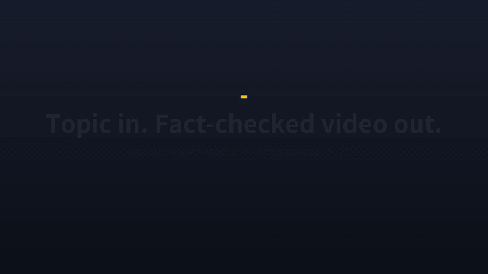
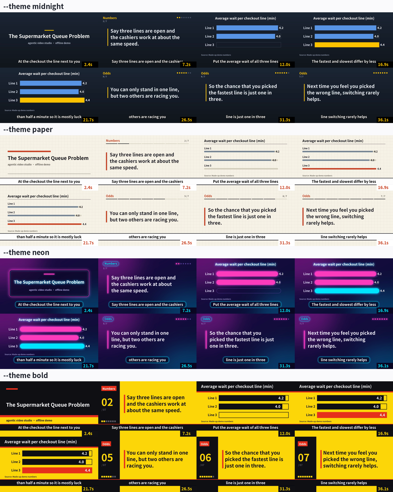

# agentic-video-studio

[](https://github.com/johnnygodsa/agentic-video-studio/actions/workflows/ci.yml)
[](LICENSE)


You give it a topic and an angle. A team of LLM agents researches the topic, writes the script and reviews it. Python tools then record the voice-over, check every line of it, and render a subtitled video with animated charts.



I built this to run a real narrated video channel. The hard part was keeping mistakes out of the finished videos: wrong numbers, misread words, subtitles cut mid-word. So every stage writes its output to disk, and a gate script checks that output before the next stage may start. When a gate fails, the run stops there and writes the reason to `production.json`. Fix the problem and `--from` picks up at that stage.

## Try it in a minute

The demo needs no GPU, no model and no API key. It runs a short sample script through the same parser, lint, subtitle splitter and gate check the full pipeline uses, and renders an MP4 of under 40 seconds.

With Docker, one command (the image is public on GitHub Container Registry):

```bash
docker run --rm -v "$PWD/out:/out" ghcr.io/johnnygodsa/agentic-video-studio --theme neon   # writes out/demo.mp4
```

Or build the image yourself:

```bash
git clone https://github.com/johnnygodsa/agentic-video-studio && cd agentic-video-studio
docker build -t avs .
docker run --rm -v "$PWD/out:/out" avs --theme neon      # writes out/demo.mp4
```

With the install script (needs Python 3.10+ and ffmpeg):

```bash
./scripts/install.sh       # Linux, macOS, WSL. Add --full for the whole pipeline.
.\scripts\install.ps1      # Windows PowerShell. Add -Full for the whole pipeline.
```

Or by hand:

```bash
pip install -r requirements-ci.txt
python -X utf8 pipeline/demo/run_demo.py --tts none --out demo_out
```

Other flags: `--theme paper|neon|bold|my_theme.json`, `--script pipeline/demo/sample_script.txt` for the Chinese sample, and `--tts piper` for a free CPU voice. You get `demo.mp4`, `demo.srt`, and `contact_sheet.png` with eight frames for a quick look. CI renders the demo on every push, and the latest run's artifacts always hold a copy.

### One script, four looks

The four strips below come from the same script with the same timing. Only `--theme` changes. Themes are plain data in `pipeline/demo/themes.py`. For your own, write a JSON file that starts from a built-in theme (`"base": "paper"`) and overrides the colors you want. The animated charts in the full pipeline take their styling from `pipeline/templates/anim/tokens.css`.



## Making a real video

```bash
python pipeline/director.py brief my_video --topic "..." --angle "..." --channel ChannelA --format commentary
python pipeline/director.py run my_video --from A --to E
```

`brief` saves the topic. `run` goes through the stages in order, and `python pipeline/director.py --explain <stage>` prints exactly what each gate checks.

| Stage | Work | Gate passes when |
|---|---|---|
| A | Agents gather sources, the audience's consensus view, and screenshots or clips | Every claim has a source and a planned visual, no fact is still unverified, all assets exist, and the estimated length meets the format's minimum |
| B | An agent writes the script; lint, an editor agent and a subject-expert agent review it | Lint, the fact check and the visual check report no errors, every line's visual points to a real file, and neither reviewer has an open objection |
| B4 | The narration text is prepared and readings are decided | Subtitle seams are clean and the pronunciation review has nothing unresolved |
| C | TTS records each line, and ASR transcribes it back | No misread words, no failed lines, the duration precheck passes, and the audio matches the frozen text |
| D | Charts, subtitles, music and the final render | The MP4 meets the length minimum, the pre-render check is clean, and the QA frame sheet exists |
| E | Title, cover, description and upload schedule | Release info is filled in, the upload is scheduled and the metadata check passes. You can still veto before it goes live |

The research, writing and review stages use Claude Code by default. `STUDIO_LLM=codex` runs the same role prompts through the OpenAI Codex CLI ([AGENTS.md](AGENTS.md)). The Codex path has unit tests but hasn't produced a whole video yet.

TTS and ASR run on your own NVIDIA GPU, on Colab or on Kaggle. With a local GPU, a lock file keeps two jobs from using it at once.


## What you could make with it

It fits videos where a narrator explains something while the screen shows charts, screenshots, clips or text. That covers science and history explainers, news recaps, product and game reviews, course modules, internal training, data stories, and long series that should keep one look and one voice across episodes. Most videos it makes are 5 to 20 minutes long, and Shorts use the same timeline.

## Setting it up for real work

Some parts you have to supply yourself:

- A TTS model and a voice you have the rights to. CosyVoice 3 is the default engine. Point `pipeline/paths.py` at the model and register the reference voice in `pipeline/cosy3_worker.py`. On a CPU-only machine, use Piper.
- [faster-whisper](https://github.com/SYSTRAN/faster-whisper) for the read-back check.
- Fonts in `fonts/`, and `gsap.min.js` in `pipeline/static/vendor/`. The `--full` install downloads GSAP for you.
- Pronunciation data. `pipeline/moe/README.md` rebuilds it from the Ministry of Education dictionary, or you can plug in your own lexicon.

Two regional conventions ship turned off: local terminology (Taiwan Mandarin in the shipped config) and showing a local-currency price next to USD. Switch either on in `studio.json`. The keys are listed in `pipeline/locale_cfg.py`.

The pronunciation and subtitle tools are tuned for Mandarin. The rule files and agent prompts are in Traditional Chinese for now, and English versions are being added. Orchestration, gates, rendering and QA work with a script in any language, and the demo itself is in English.

The publishing and analytics scripts (`yt_queue.py`, `stats.py`, `feedback*.py`) talk to an external backend that isn't part of this repo. Without it they say the backend is missing, and the rest of the pipeline keeps working.

For the full pipeline you need Python 3.10+, FFmpeg, Playwright Chromium for the charts, and an NVIDIA GPU with at least 8 GB (or a Colab or Kaggle account) for TTS and ASR. It is developed on Windows 10/11, and CI runs on Ubuntu.

## Where things are

| Path | Contents |
|---|---|
| `CLAUDE.md`, `AGENTS.md` | Rules the lead agent reads every turn (Claude Code and Codex) |
| `channel/規則/` | Production rules: workflow, topic choice, scripting and fact checks, production and audio QC, delivery |
| `.claude/agents/` | One prompt per agent role |
| `pipeline/director.py`, `director_ab.py` | The director: `brief`, `run`, `--explain`, state in `production.json` |
| `pipeline/gates/` | One gate per stage |
| `pipeline/tts_*.py`, `cosy3_worker.py`, `asr_worker.py` | Voice-over, read-back and pronunciation checks |
| `pipeline/build.py`, `anim_*.py`, `templates/` | Timeline, rendering, chart templates |
| `pipeline/script_lint.py`, `facts_*.py` | Script lint and fact checks |
| `pipeline/llm.py` | Every agent call goes through here; switches between Claude Code and Codex |
| `pipeline/demo/` | The offline demo and its themes |
| `pipeline/tests/` | Tests. `.github/ci_tests.txt` lists the 73 that run offline in CI |

## Contributing

Bug reports and pull requests are welcome. Good places to start are chart templates, themes, rule files for another language, and adapters for other TTS engines or LLM CLIs. [CONTRIBUTING.md](CONTRIBUTING.md) explains how to run the checks.

## Before you publish

You are responsible for the rights to any footage, screenshots or trailers the pipeline captures. The fact gates make wrong claims less likely but can't rule them out, so read the script before the video goes out.

## License

[MIT](LICENSE) © 2026 johnnygodsa
