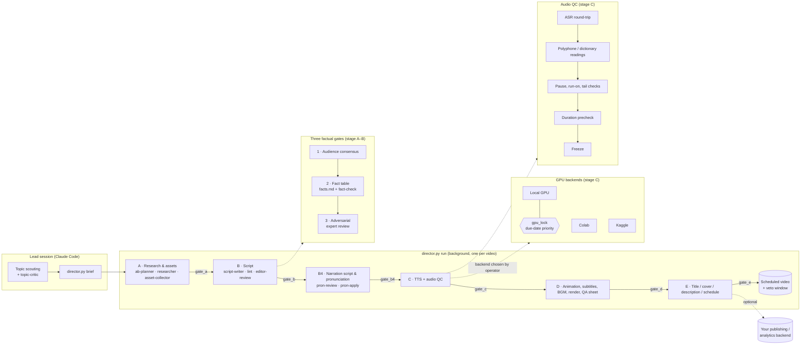

# agentic-video-studio

[](https://github.com/johnnygodsa/agentic-video-studio/actions/workflows/ci.yml)
[](LICENSE)


**Turn a topic into a finished, fact-checked, narrated video with a team of AI agents.**

You pick the topic. A director process takes the video through research, script, voice-over, animation, subtitles and render. Each stage has a gate. Claude Code sub-agents do the research, writing and adversarial review. A local Python toolchain handles TTS, pronunciation QA, motion graphics and the final render.
Nothing moves forward until its gate passes, so mistakes are caught at the stage where they happen instead of in the comments after you publish.

中文說明見 [README.zh-TW.md](README.zh-TW.md).


<sub>Chart templates (bars with axis-shock, line, KPI, before/after) rendered frame by frame from JSON. Data is made up.</sub>

## What you can make with it

The pipeline suits any **narration-driven video** where accuracy matters and visuals come from charts, screenshots, clips and text cards:

- **Explainers and video essays**: science, history, technology, economics, law, health literacy
- **News recaps and analysis**: industry news, product launches, policy changes, weekly roundups
- **Reviews and comparisons**: games, apps, gadgets, books, films, services, with prices and specs checked
- **Education and training**: course modules, onboarding videos, internal knowledge bases, tutorials
- **Data stories**: market trends, sports statistics, survey results, turned into animated charts
- **Faceless channels and series**: consistent format, voice and style across dozens of episodes
- **Repurposing**: long articles, reports, newsletters and threads into scripted videos

It is built for long-form (5–20 min) content. Shorts are supported through the same timeline.

## Why it is different

| | |
|---|---|
| **Hard stage gates** | A → B → B4 → C → D → E. A gate checks real artifacts (files, reports, QA results), not an LLM's say-so. Blockers go to `production.json`, and any stage can be resumed. |
| **Three factual gates** | Every script passes **audience consensus → a per-claim fact table → an adversarial domain-expert review** before a single line is voiced. |
| **Audio QC for people who can't listen** | The operator and the LLM can't hear the narration, so every line is checked automatically: ASR round-trip, polyphone and dictionary readings, pause and run-on detectors, and duration prechecks. Audio is frozen only when every line passes. |
| **Your look, not ours** | Backgrounds, colors, layouts, fonts, subtitle styles and chart templates are data (`pipeline/demo/themes.py`, `pipeline/templates/anim/tokens.css`). Swap a theme and the same script comes out looking like a different channel. |
| **Drive it with Claude Code or Codex** | All agent calls go through one function (`pipeline/llm.py`). `STUDIO_LLM=codex` switches the whole pipeline to the OpenAI Codex CLI, and `AGENTS.md` gives Codex the same rules. |
| **Agents with narrow jobs** | Researcher, planner, asset collector, script writer, editor, fact-checker, expert reviewer, pronunciation reviewer, line fixer. Each prompt lives in `.claude/agents/` and can be edited. |
| **Remote or local GPU** | TTS and ASR run on Colab, Kaggle or your own GPU, behind a machine-wide lock with due-date priority. |
| **Motion graphics from templates** | Bar and line charts, timelines, reader cards and title scenes, built in HTML/GSAP and rendered frame by frame with Playwright. |
| **Rules as files** | Production rules are Markdown in `channel/規則/`, and `CLAUDE.md` routes the agents to them. Change your house style once and every agent follows it. |

## Try it in 1 minute: offline demo

No GPU, no models, no API key. The demo runs `pipeline/demo/sample_script.txt` through the real pipeline modules: script parser, script lint, pronunciation annotation, subtitle splitting (no punctuation, no broken words), a stage-gate check, chart and title-card drawing, ffmpeg encoding, and a QA contact sheet.

```bash
# Python 3.10+, ffmpeg on PATH; Linux: apt install fonts-noto-cjk
pip install -r requirements-ci.txt
python -X utf8 pipeline/demo/run_demo.py --tts none --out demo_out
# other looks: --theme paper | neon | bold | my_theme.json
# Chinese sample: --script pipeline/demo/sample_script.txt
# optional CPU voice: pip install piper-tts, then --tts piper
```

You get `demo.mp4` with burned-in subtitles, `demo.srt`, `contact_sheet.png`, `pron.txt` and `script.json`. Each step prints a `[stage] ...` line, and if any gate check fails the run stops before rendering.
CI renders the same demo on every push. Download it from the run's `demo` artifact.


### Same script, four looks

Every frame below comes from the same script, the same timing and the same 8-shot QA sheet. Only the theme changes: background, palette, layout, title card, chart style and subtitle treatment.


To make your own theme, copy a JSON file with `"base": "paper"` (or any built-in theme) and override any color key. To change the layout, add a theme in `pipeline/demo/themes.py`. Production charts use the same idea: edit `pipeline/templates/anim/tokens.css` to restyle every animated chart at once.

## How it works



Deep dive: [docs/ARCHITECTURE.md](docs/ARCHITECTURE.md).

## Make it yours

### Language and regional conventions

Two regional conventions are built in: preferred local terminology, and showing prices in a local currency next to USD. Both are **optional**. You switch them in `studio.json` at the repo root:

```json
{
  "locale": {
    "regional_terms": false,
    "regional_terms_name": "Taiwan Mandarin usage",
    "price_local_currency": false,
    "local_currency_regex": "€|EUR|euro",
    "local_currency_name": "EUR"
  }
}
```

This repository ships with both switches **off**. Set them to `true` to have the script lint and the line-fix agent enforce them (`pipeline/locale_cfg.py` documents every key).
The bundled pronunciation and subtitle tools are tuned for Mandarin Chinese, and the shipped rule files and agent prompts are written in Traditional Chinese. Orchestration, gates, rendering and QA work in any language: write your own rule files and point the TTS step at your engine.

### LLM backend: Claude Code or Codex

Claude Code is the default. To drive the whole pipeline with the [OpenAI Codex CLI](https://github.com/openai/codex), set `STUDIO_LLM=codex`, or put `{"llm": {"backend": "codex"}}` in `studio.json`. Sub-agent role prompts are read from `.claude/agents/` and passed to `codex exec`; roles that need to write files get the `workspace-write` sandbox, and all others run read-only. `AGENTS.md` explains how Codex should read the rules. The Codex backend is new and covered by unit tests only, so please open an issue if a live run fails.

### Voice, models and assets

- **TTS**: [CosyVoice 3](https://github.com/FunAudioLLM/CosyVoice) is the default engine. Point `pipeline/paths.py` (or its environment variables) at your model directory and register a reference voice you have rights to in `pipeline/cosy3_worker.py`. Piper works for CPU-only setups.
- **ASR verification**: [faster-whisper](https://github.com/SYSTRAN/faster-whisper). Other engines are in `pipeline/tts_bakeoff/`.
- **Pronunciation dictionary**: `pipeline/moe/README.md` rebuilds it from the Ministry of Education dictionary (CC BY-ND 3.0 TW), or you can plug in your own lexicon.
- **Fonts**: put CJK or Latin fonts in `fonts/` (e.g. Noto Sans TC).
- **GSAP**: download `gsap.min.js` (v3) from <https://gsap.com> or run `npm i gsap`, then place it at `pipeline/static/vendor/gsap.min.js`.
- **Publishing and analytics**: `yt_queue.py`, `stats.py` and `feedback*.py` talk to an external backend through files and a CLI. Without one they say the backend is missing, and the rest of the pipeline keeps working.

### Channels and house style

Copy `channel/規則/頻道_模板.md` once per channel or series to set tone, length, pacing and audience persona. Rules that apply to every channel go in the numbered rule files.

## Requirements

- Python 3.10+, FFmpeg on `PATH`
- Playwright Chromium for animations (`python -m playwright install chromium`)
- NVIDIA GPU (≥ 8 GB) for local TTS/ASR, or a Colab / Kaggle account
- [Claude Code](https://docs.claude.com/en/docs/claude-code) for the agent layer
- Windows 10/11 is the main target (some helpers use PowerShell OCR). Most of the code is portable Python, and CI runs on Ubuntu.

```bash
python -m pip install -r requirements.txt
```

TTS engines are installed in separate virtual environments (see `pipeline/colab/req_*.txt`).

## Repository layout

| Path | What |
|---|---|
| `CLAUDE.md` | Rules Claude Code loads every turn; a routing table to the rule files |
| `channel/規則/` | Production rules: `0_流程` workflow, `1_選題` topic selection, `2_文案` scripting & fact gates, `3_製作` production/TTS/QA, `4_交付發片` delivery; `頻道_模板.md` channel template |
| `.claude/agents/` | Sub-agent prompts |
| `pipeline/director.py`, `director_ab.py` | Director: `brief`, `run --from A --to E`, `--explain <stage>`, state in `production.json` |
| `pipeline/gates/` | Stage gates A, B, B4, C, D, E and their specs |
| `pipeline/tts_*.py`, `cosy3_worker.py`, `asr_worker.py` | TTS dispatch, workers, ASR verification, pronunciation and QC tools |
| `pipeline/colab/`, `pipeline/remote/` | Colab notebook/packer and Kaggle runner |
| `pipeline/build.py`, `make_version.py`, `anim_*.py`, `templates/` | Timeline build, rendering, animation templates |
| `pipeline/facts_*.py`, `script_lint.py`, `script_structure.py`, `speakable.py` | Script lint and fact checking |
| `pipeline/locale_cfg.py` | Regional-convention switches (`studio.json`) |
| `pipeline/demo/` | The offline demo |
| `pipeline/tests/` | pytest suite with synthetic fixtures |
| `pipeline/docs/` | Module docs (start at `pipeline/README.md`) |
| `projects/_templates/`, `projects/framework/` | Brief / handoff / visual-table templates and format specs |

## Good to know

- Media rights are your responsibility. The pipeline automates capture and editing of footage, screenshots, trailers and other third-party material, but you need to check the copyright and fair-use rules that apply to you.
- Generated narration can still be wrong. The fact gates make errors much less likely but cannot rule them out, and you are responsible for what you publish.
- Tests that need a GPU, models or an external backend are skipped in CI. `.github/ci_tests.txt` lists the offline suite.

## Contributing

Issues and pull requests are welcome, especially new chart templates, themes, language packs and engine adapters. See [CONTRIBUTING.md](CONTRIBUTING.md).

## License

[MIT](LICENSE) © 2026 johnnygodsa
