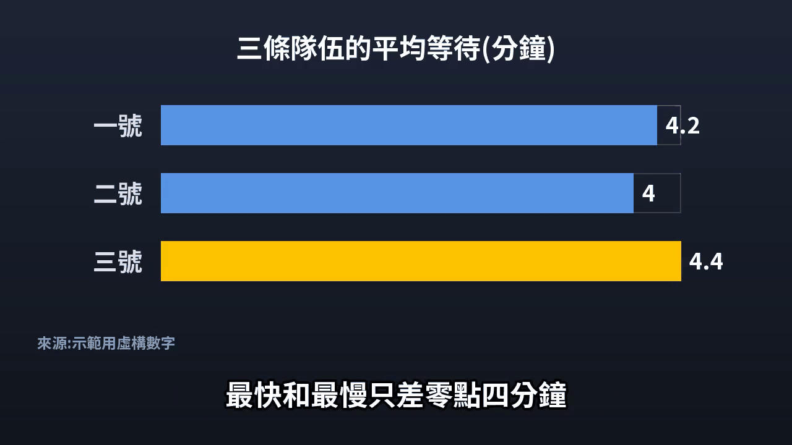
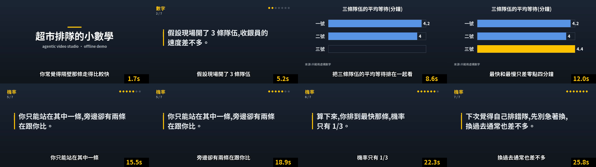
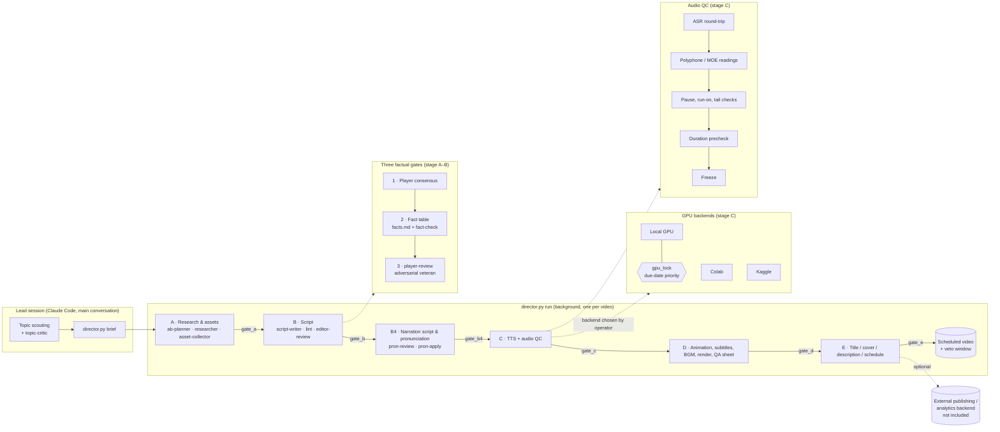

# agentic-video-studio

[](https://github.com/johnnygodsa/agentic-video-studio/actions/workflows/ci.yml)

An agent-orchestrated production pipeline for long-form, fact-checked commentary videos (Traditional Chinese narration, gaming / pop-science topics).
A lead "director" process drives each video through gated stages; Claude Code sub-agents do research, writing and review; a local Python toolchain does TTS, pronunciation QA, animation, subtitles and rendering.

This repository is the **framework** extracted from a working private studio: pipeline code, stage gates, agent prompts and production rules.
It deliberately contains **no models, voices, footage, per-video data, channel analytics or credentials** (see [What is not included](#what-is-not-included)).

> Language note: code comments, rule files (`channel/規則/`) and agent prompts (`.claude/agents/`) are written in Traditional Chinese, as they are used in production. This README and `docs/ARCHITECTURE.md` are in English. 中文說明見 [README.zh-TW.md](README.zh-TW.md).

## Quickstart: offline demo (no GPU, no models, no Claude)

Renders a ~28-second sample video from `pipeline/demo/sample_script.txt` by running it through the real pipeline modules:
script parser (`script_txt2json`), script lint (`script_lint`), pronunciation annotation (`tts_cosy_text.apply_pron`),
subtitle splitting with no punctuation and no broken words (`build.split_phrases`, `text_wrap`), a stage-gate check (`director._item`, as in `pipeline/gates/`),
Pillow-drawn title card / bar chart / text cards, ffmpeg encoding and a QA contact sheet (`qa_sheet.grab`).

```bash
# Python 3.10+, ffmpeg on PATH; Linux: apt install fonts-noto-cjk (Windows uses Microsoft JhengHei)
pip install -r requirements-ci.txt
python -X utf8 pipeline/demo/run_demo.py --tts none --out demo_out
# optional CPU voice: pip install piper-tts, then --tts piper (voice downloads to demo_out/cache; falls back to silence on failure)
```

Output in `demo_out/`: `demo.mp4` (burned-in subtitles), `demo.srt`, `contact_sheet.png`, plus `pron.txt` (annotated readings) and `script.json`.
Each step logs a short `[stage] ...` line; the gate stops before rendering if any check fails.
CI runs the same demo on every push (download it from the run's `demo` artifact) together with the offline test list in `.github/ci_tests.txt`.




## What it does

- **Topic → brief → research → script → voice → render → delivery**, one director process per video, resumable from any stage.
- **Hard stage gates** (`pipeline/gates/gate_*.py`): a stage cannot start until the previous gate passes; blockers are written to `production.json`.
- **Three factual gates** before any narration is recorded: player-consensus check → per-claim fact table → adversarial "veteran player" review.
- **Pronunciation & TTS QC as the only audio gate**: the operator (and the LLM) cannot listen, so every line is checked by ASR round-trip, polyphone rules, a Ministry-of-Education reading dictionary, pause/run-on detectors and duration prechecks before audio is frozen.
- **Remote GPU scheduling**: TTS/ASR runs on Colab, Kaggle or the local GPU behind a machine-wide GPU lock with due-date priority.
- **Templated motion graphics** (HTML/GSAP rendered through Playwright) for charts, timelines, reader cards and brand scenes.

## Architecture



Details: [docs/ARCHITECTURE.md](docs/ARCHITECTURE.md).

## Repository layout

| Path | What |
|---|---|
| `CLAUDE.md` | Project rules loaded by Claude Code every turn (routing table to the rule files) |
| `channel/規則/` | Production rules: `0_流程` workflow, `1_選題` topic selection, `2_文案` scripting & fact gates, `3_製作` production/TTS/QA, `4_交付發片` delivery; `頻道_模板.md` per-channel template |
| `.claude/agents/` | Sub-agent prompts (researcher, script-writer, fact-check, player-review, editor-review, pron-review, …) |
| `pipeline/director.py`, `director_ab.py` | Director: `brief`, `run --from A --to E`, `--explain <stage>`, `production.json` state |
| `pipeline/gates/` | Stage gates A, B, B4, C, D, E and their specs |
| `pipeline/tts_*.py`, `cosy3_worker.py`, `asr_worker.py` | TTS dispatch, CosyVoice3 worker, ASR verification, pronunciation and QC tools |
| `pipeline/colab/`, `pipeline/remote/` | Colab notebook/packer and Kaggle runner for remote GPU |
| `pipeline/gpu_lock.py`, `gpu_lock_local.py` | GPU lock shim + standalone single-machine lock |
| `pipeline/build.py`, `make_version.py`, `anim_*.py`, `templates/`, `sci/` | Timeline build, rendering, animation templates |
| `pipeline/facts_*.py`, `script_lint.py`, `script_structure.py`, `speakable.py` | Script lint and fact checking |
| `pipeline/stats.py`, `yt_queue.py`, `feedback*.py`, `context_pack.py` | Analytics / publishing clients for an optional external backend |
| `pipeline/tests/` | pytest suite (with synthetic fixtures) |
| `pipeline/docs/` | Module docs (`README.md` in `pipeline/` is the entry) |
| `projects/_templates/`, `projects/framework/` | Brief / handoff / visual-table templates and format specs |

Channel names in rules and code were replaced with neutral placeholders (`ChannelA`, `ChannelB`, `ChannelC`); paths to private machines with `<REPO_ROOT>`, `<EXTERNAL_BACKEND>`, `<HOME>`, `<LOCAL_PATH>`.

## Requirements

- Windows 10/11 (several helpers use Windows APIs / PowerShell OCR; most code is portable Python)
- Python 3.10+
- FFmpeg on `PATH`
- Node-free: animations render via Playwright Chromium (`python -m playwright install chromium`)
- NVIDIA GPU (≥ 8 GB) for local TTS/ASR, or a Colab / Kaggle account
- [Claude Code](https://docs.claude.com/en/docs/claude-code) for the agent layer

```bash
python -m pip install -r requirements.txt
```

TTS engines are installed in separate virtual environments (see `pipeline/colab/req_*.txt`).

## Bring your own TTS model and voice

No model weights, voice prompts or reference audio are shipped.

1. Get CosyVoice 3 from the official source: <https://github.com/FunAudioLLM/CosyVoice> (weights on Hugging Face / ModelScope under their own licenses).
2. Create a venv for it and point `pipeline/paths.py` (or its environment variables) at the model directory.
3. Record or license a reference voice you have rights to, and register it as the speaker prompt used by `pipeline/cosy3_worker.py`.
4. ASR verification uses [faster-whisper](https://github.com/SYSTRAN/faster-whisper) (other engines in `pipeline/tts_bakeoff/` are optional).
5. The pronunciation dictionary data (`pipeline/moe/`) is derived from the Ministry of Education *Revised Mandarin Chinese Dictionary* (CC BY-ND 3.0 TW) and is **not redistributed**; rebuild it with the command in `pipeline/moe/README.md`.

Fonts are not included either; put your own CJK fonts in `fonts/` (e.g. Noto Sans TC).

## What is not included

- TTS / ASR models, virtual environments, voice files and reference audio
- Raw footage, screenshots, animation renders, BGM, builds and finished videos
- Per-video folders, scripts, research notes and per-video asset scripts
- Audience comments, performance metrics, A/B test results and channel strategy files
- The external publishing / analytics backend (`yt_queue.py`, `stats.py`, `feedback*.py` talk to it through files and CLI; without it those commands report that the backend is missing)
- Any secrets, tokens, cookies or OAuth files

## GPU lock

`pipeline/gpu_lock.py` first looks for a shared cross-project lock under `<EXTERNAL_BACKEND>/_shared/` (env `YT_SHARED_DIR`). When it is absent it falls back to `pipeline/gpu_lock_local.py`, a self-contained single-machine mutex (`tmp/.gpu_lock/`, PID liveness check, optional VRAM threshold via `nvidia-smi`). No extra setup is needed.

## Limitations and disclaimer

- This is a production tool for one studio, published as reference; expect hard-coded conventions (Traditional Chinese, Taiwan terminology, NTD prices).
- Tests that depend on the excluded backend, models or data may be skipped or fail.
- **Copyright of game footage, screenshots, trailers and third-party media is the user's responsibility.** The pipeline only automates capture and editing; check the rights and fair-use rules that apply to you.
- Generated narration may be wrong; the fact gates reduce but do not eliminate errors. You are responsible for what you publish.
- GSAP is **not** bundled. Download `gsap.min.js` (v3) from https://gsap.com or `npm i gsap` and place it at `pipeline/static/vendor/gsap.min.js`.

## License

[MIT](LICENSE) © 2026 johnnygodsa
