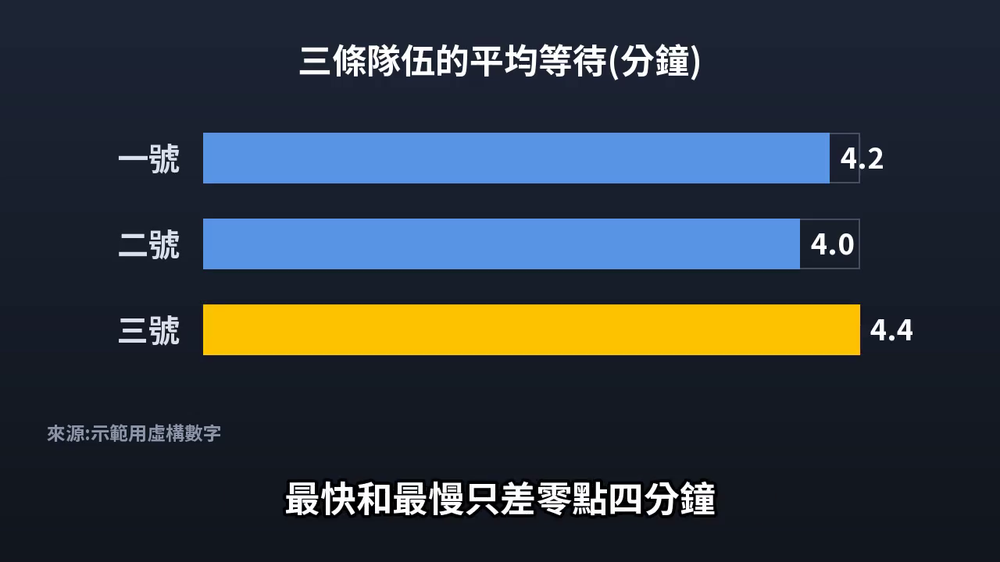
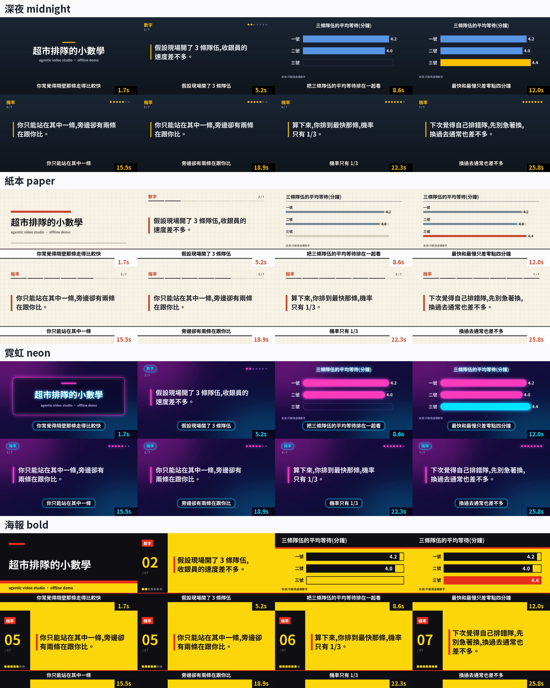

# agentic-video-studio

[](https://github.com/johnnygodsa/agentic-video-studio/actions/workflows/ci.yml)
[](LICENSE)


**給一個題目,AI 代理團隊做出查證過、有配音、可直接上片的完整影片。**

你只要選題。director 程序帶著影片依序走過查證、文案、配音、動畫、字幕、渲染,每一段都有關卡;查證、寫稿和對抗式審稿交給 Claude Code 子代理,配音、讀音品管、動態圖表和最後渲染交給本機 Python 工具鏈。
關卡不過就不往下走,錯誤在發生的那一段就被攔下,不會等到上片後才在留言區被指出來。

English: [README.md](README.md)


<sub>圖表模板(長條圖含軸暴衝、折線、KPI、前後對照)由 JSON 逐格渲染;數字是虛構的。</sub>

## 可以拿來做什麼

凡是**以旁白為主、講究正確**,畫面用圖表、截圖、片段和文字卡組成的影片都適用:

- **知識解說與影片論述**:科學、歷史、科技、經濟、法律、健康識讀
- **新聞整理與評析**:產業新聞、新品發表、政策變動、每週懶人包
- **評測與比較**:遊戲、App、3C、書籍、電影、服務,價格與規格都會查證
- **教學與培訓**:課程單元、新人訓練、企業內部知識庫、操作教學
- **數據故事**:市場趨勢、運動數據、調查結果,做成動態圖表
- **不露臉頻道與系列節目**:幾十集都維持同樣的格式、聲音和風格
- **內容轉製**:長文、報告、電子報、討論串改寫成有腳本的影片

主要支援 5–20 分鐘的長片;短影音走同一套時間軸。

## 特色

| | |
|---|---|
| **段間硬關卡** | A → B → B4 → C → D → E。關卡檢查的是檔案、報告、品管結果這些實際產出,不是 LLM 自己說做完了;卡點寫進 `production.json`,任一段都能續跑。 |
| **三道事實閘門** | 每份文案配音前都要過:**受眾共識 → 逐條事實核對表 → 扮演領域專家的對抗式審稿**。 |
| **聽不到也能把關配音** | 操作者和 LLM 都聽不到旁白,所以每句自動檢查:語音辨識回讀、多音字與辭典讀音、停頓與連讀偵測、時長預檢。全部通過才凍結音檔。 |
| **風格由你決定** | 背景、配色、排版、字型、字幕樣式和圖表模板都是資料(`pipeline/demo/themes.py`、`pipeline/templates/anim/tokens.css`);換一套主題,同一份文案就像另一個頻道做的。 |
| **Claude Code 或 Codex 都能驅動** | 所有代理呼叫都走同一個函式(`pipeline/llm.py`);設 `STUDIO_LLM=codex` 就整條流程改用 OpenAI Codex CLI,`AGENTS.md` 讓 Codex 讀到同一套規則。 |
| **代理分工明確** | 查證員、規劃員、素材員、寫稿員、編輯、事實審、專家審、讀音審、改句員;提示詞都在 `.claude/agents/`,可以直接改。 |
| **遠端或本機 GPU** | 配音與辨識可跑 Colab、Kaggle 或自己的 GPU;本機有全機 GPU 鎖,依到期日排序。 |
| **模板化動態圖表** | 長條圖、折線圖、時間軸、閱讀卡、片頭場景,用 HTML/GSAP 寫成,Playwright 逐格渲染。 |
| **規則就是檔案** | 製作規則是 `channel/規則/` 裡的 Markdown,`CLAUDE.md` 告訴代理去哪裡讀;風格改一次,所有代理都照新規則做。 |

## 1 分鐘體驗:離線示範

不需要 GPU、模型或 API 金鑰。示範會把 `pipeline/demo/sample_script.txt` 走過正式產線模組:文案解析、文案檢查、讀音標注、字幕切段(無標點、不拆詞)、關卡檢查、圖表與標題卡繪製、ffmpeg 合成、QA 總覽圖。

```bash
# Python 3.10 以上、ffmpeg 在 PATH;Linux 需 apt install fonts-noto-cjk
pip install -r requirements-ci.txt
python -X utf8 pipeline/demo/run_demo.py --tts none --script pipeline/demo/sample_script.txt --out demo_out
# 換風格:--theme paper | neon | bold | 自訂.json;不加 --script 是英文範例
# 選用 CPU 配音:pip install piper-tts 後改 --tts piper
```

會產出 `demo.mp4`(字幕燒進畫面)、`demo.srt`、`contact_sheet.png`、`pron.txt` 和 `script.json`。每一步印一行 `[stage] ...`;任一關卡檢查沒過,就停在渲染前。
CI 每次 push 都會渲染同一支示範片,可以從該次執行的 `demo` artifact 下載。



### 同一份文案,四種風格

下面每一格都來自同一份文案、同樣的時間軸、同一張 8 格 QA 總覽圖,只換了主題:背景、配色、排版、標題卡、圖表樣式和字幕處理都不一樣。



自訂主題:寫一個 JSON,用 `"base": "paper"`(或任一內建主題)當底,覆寫想改的顏色鍵即可;要改排版,就到 `pipeline/demo/themes.py` 新增主題。正式產線的圖表也是同樣做法:改 `pipeline/templates/anim/tokens.css`,所有動態圖表一次換風格。

## 運作方式

流程圖與各段說明見 [README.md](README.md#how-it-works) 與 [docs/ARCHITECTURE.md](docs/ARCHITECTURE.md)。

## 依你的需求調整

### 語言與地區慣例

內建兩項地區慣例:使用在地用語,以及價格在美金旁另標本地幣。兩項都**可選**,在 repo 根目錄的 `studio.json` 開關:

```json
{
  "locale": {
    "regional_terms": true,
    "regional_terms_name": "台灣用語",
    "price_local_currency": true,
    "local_currency_regex": "NT\\s?\\$|台幣|TWD",
    "local_currency_name": "台幣"
  }
}
```

本庫預設兩項都**關閉**。改成 `true` 後,文案檢查和改句代理就會強制執行(所有鍵的說明在 `pipeline/locale_cfg.py`)。
內附的讀音與字幕工具針對中文調校,規則檔和代理提示詞用繁體中文撰寫。流程調度、關卡、渲染、品管則不限語言:換成自己的規則檔,配音那一步接上你用的引擎即可。

### LLM 後端:Claude Code 或 Codex

預設使用 Claude Code。設定 `STUDIO_LLM=codex`,或在 `studio.json` 寫 `{"llm": {"backend": "codex"}}`,整條流程就改用 [OpenAI Codex CLI](https://github.com/openai/codex) 驅動。子代理的角色提示詞從 `.claude/agents/` 讀出來交給 `codex exec`:需要寫檔的角色用 `workspace-write` 沙箱,其他角色一律唯讀。Codex 怎麼讀規則寫在 `AGENTS.md`。Codex 後端是新功能,目前只有單元測試;實際執行失敗請開 issue。

### 聲音、模型與素材

- **配音**:預設引擎是 [CosyVoice 3](https://github.com/FunAudioLLM/CosyVoice)。在 `pipeline/paths.py`(或對應的環境變數)指定模型目錄,再到 `pipeline/cosy3_worker.py` 登記一段你有使用權的參考音;只有 CPU 的環境可以用 Piper。
- **配音驗證**:[faster-whisper](https://github.com/SYSTRAN/faster-whisper);其他引擎在 `pipeline/tts_bakeoff/`。
- **讀音辭典**:照 `pipeline/moe/README.md` 用教育部辭典(CC BY-ND 3.0 TW)重建,或接上你自己的詞庫。
- **字型**:放到 `fonts/`(例如 Noto Sans TC)。
- **GSAP**:從 <https://gsap.com> 下載 `gsap.min.js`(v3),或執行 `npm i gsap`,放到 `pipeline/static/vendor/gsap.min.js`。
- **發布與數據**:`yt_queue.py`、`stats.py`、`feedback*.py` 透過檔案和 CLI 跟外部後端溝通;沒有後端時會提示缺少後端,其餘流程照常運作。

### 頻道與風格

每個頻道或系列複製一份 `channel/規則/頻道_模板.md`,設定語氣、片長、節奏與觀眾人設;所有頻道共用的規則寫在編號規則檔。

## 需求

- Python 3.10 以上,FFmpeg 在 `PATH`
- 動畫用 Playwright Chromium(`python -m playwright install chromium`)
- 本機配音與辨識需 NVIDIA GPU(≥ 8 GB),或使用 Colab / Kaggle 帳號
- 代理層需 [Claude Code](https://docs.claude.com/en/docs/claude-code)
- 主要在 Windows 10/11 上使用(部分工具用 PowerShell OCR);大部分程式是跨平台 Python,CI 在 Ubuntu 上執行

```bash
python -m pip install -r requirements.txt
```

配音引擎各自裝在獨立虛擬環境(見 `pipeline/colab/req_*.txt`)。

## 注意事項

- 素材的版權由使用者自行負責。本流程會自動擷取與剪輯影片、截圖、預告片和其他第三方素材,適用的著作權與合理使用規定請自行確認。
- 生成的旁白仍可能出錯。事實閘門能大幅降低出錯機率,但無法完全杜絕;發布內容由你負責。
- 需要 GPU、模型或外部後端的測試在 CI 中略過;離線測試清單在 `.github/ci_tests.txt`。

## 參與貢獻

歡迎開 issue 或送 PR,尤其是新的圖表模板、主題、語言包與引擎轉接。詳見 [CONTRIBUTING.md](CONTRIBUTING.md)。

## 授權

[MIT](LICENSE) © 2026 johnnygodsa
