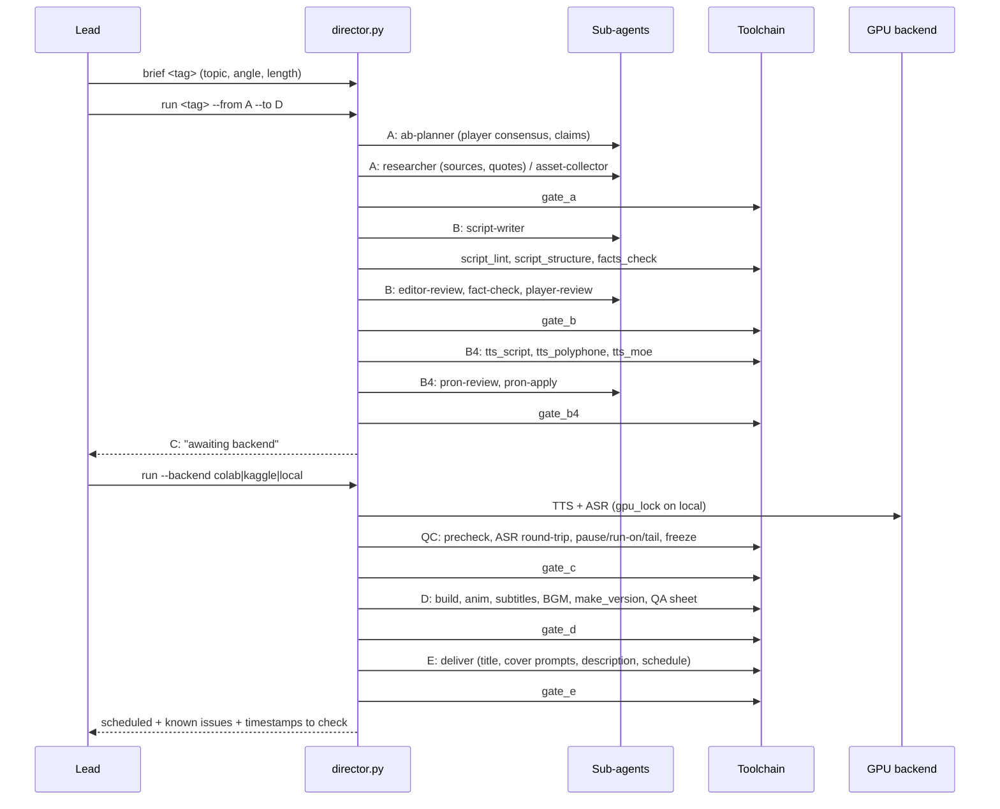

# Architecture

This document describes how the studio is organized: who decides, who does the work, and which checks stand between an idea and a published video.

## 1. Roles

| Role | Runs as | Responsibility |
|---|---|---|
| Lead (main conversation) | Claude Code session | Topic selection, asking the operator the few questions only a human can answer, reviewing results, deciding on blockers |
| Director | `pipeline/director.py run <tag>` in the background | Drives one video through stages A→E, calls agents and tools, writes `production.json` |
| Sub-agents | `.claude/agents/*.md` | Narrow, single-purpose workers with strict output formats (JSON or fixed markdown) |
| Toolchain | `pipeline/*.py` | Deterministic work: lint, fact matching, TTS, ASR, QC, animation, rendering |
| Operator | Human | Answers kickoff questions, picks a GPU backend when asked, may veto in the window after scheduling |

Design rules that shaped the code:

- **Gates over judgment.** Every stage ends in a programmatic gate (`pipeline/gates/gate_a.py` … `gate_e.py`, thresholds in `gates/specs.py`). A stage never starts if the previous gate failed; the failure reasons are stored as `blocks` in `production.json` and shown by `director.py status`.
- **Explainable stages.** `director.py --explain <stage>` prints what a stage does, its inputs, outputs and gate checks.
- **One video, one director process, one conversation.** State lives in files (`projects/<tag>/…`, `build/<tag>/…`), so any stage can be resumed with `run --from <stage>`.
- **Agents never see the whole project.** Each agent receives a context pack (`pipeline/context_pack.py`) with only what it needs, which keeps cost and drift down.

## 2. Stages

### A — Research and assets
- `ab-planner` turns the brief, prior context and public discussion into **player consensus** and a list of claims, each with a planned visual.
- `researcher` fetches sources and extracts verbatim quotes; it collects, it does not conclude.
- `asset-collector` captures web screenshots and clips per claim (`news_lib.py`, `clips_lib.py`, `clip_scan.py`).
- `gate_a`: every claim has a source and an asset.

### B — Script
- `script-writer` writes `script.txt` from plan, facts and assets.
- Deterministic checks: `script_lint.py` (style, banned patterns, opening rules), `script_structure.py` (pacing/structure), `speakable.py`, `facts_check.py` (numbers, dates, names against `facts.md`).
- `editor-review` covers only what lint cannot: continuity, repetition, transitions.
- `fact-check` checks each sentence against the fact table for *errors* only.
- `player-review` plays a veteran player of the game/topic and flags anything players would call wrong.
- `line-fix` applies mechanical rewrites returned by the checks, as JSON.

### Three factual gates
1. **Player consensus** — the script may not contradict what players broadly agree on.
2. **Fact table** — every factual claim maps to a row in `facts.md` with a first-hand source.
3. **Player review** — adversarial review by a separate agent with no stake in the draft.

All three must pass; there is no override flag.

### B4 — Narration script and pronunciation
- `tts_script.py` turns the script into a narration script with segment boundaries.
- `tts_polyphone.py`, `tts_moe.py`, `pron_rules.json`, `pron_memory.json`, `cosy_pron.json` resolve polyphonic characters and English terms (`tts_terms.py`, `say_terms.json`).
- `pron-review` flags risky breaks and readings; `pron-apply` writes accepted rules back to the rule files.

### C — TTS and audio QC
- `tts_dispatch.py` selects the backend: `pipeline/colab/` (packed zip + notebook), `pipeline/remote/kaggle_run.py`, or local (`cosy3_worker.py`).
- Local GPU work is serialized by `gpu_lock.py` (see §4).
- QC (`3_製作` §5 in the rules) is the only audio gate, because nobody in the loop listens:
  - `tts_precheck.py` duration prediction,
  - `asr_worker.py` / `tts_asr.py` ASR round-trip and character-level diff,
  - `tts_pron_verify.py`, `tts_tone.py` reading verification,
  - `tts_pause.py`, `tts_runon.py`, `tts_tail.py` pauses, comma run-ons and clipped tails,
  - failed lines are rewritten and re-synthesized, never whitelisted.
- `freeze.py` freezes audio only when QC failures and precheck failures are both zero.

### D — Build and render
- `build.py` assembles the timeline: audio, subtitles (`text_wrap.py`, `sub_*.py`), visuals from the per-sentence visual table, BGM (`audio_consts.py`).
- `anim_*.py` + `pipeline/templates/` render charts, timelines, reader cards; `pipeline/sci/` holds brand/scene templates.
- `make_version.py` renders with FFmpeg (NVENC when available); `qa_sheet.py`, `visual_check.py` produce QA contact sheets.

### E — Delivery
- `deliver.py` produces the description file, chapter markers, titles and cover-image prompts.
- Scheduling and analytics go through an **optional external backend (not included)** via `yt_queue.py`, `stats.py`, `feedback.py`. Without it, delivery stops at local files.
- After scheduling, the operator gets a veto window; if they do nothing the video publishes on schedule.

## 3. Feedback loop

`feedback.py`, `feedback_report.py`, `audience_model.py` and `topic_scout.py` turn post-publication metrics and comments (from the external backend) into inputs for the next topic decision and for `topic-critic`. The public repository ships only synthetic fixtures for these.

## 4. GPU scheduling

- `gpu_lock.py` is a thin shim. If a shared lock module exists at `$YT_SHARED_DIR/gpu_lock.py`, it is used so that several projects on one machine share one lock with **due-date priority** (earliest publish date first) and a VRAM threshold.
- Otherwise `gpu_lock_local.py` provides a standalone lock: `holder.json` created with `O_EXCL`, stale-PID cleanup, re-entrancy through the `YT_GPU_LOCK` environment variable, optional `nvidia-smi` VRAM check.
- Remote backends (Colab/Kaggle) do not take the local lock; the director stops at `awaiting backend` and the operator chooses — the pipeline never silently reroutes.

## 5. Files and state

| File | Owner | Purpose |
|---|---|---|
| `projects/<tag>/brief.json` | Lead | Topic, angle, length, channel |
| `projects/<tag>/production.json` | Director | Stage, status, artifacts, `blocks` |
| `projects/<tag>/facts.md` | A/B | Fact table |
| `<tag>/script.txt` | B | Script |
| `build/<tag>/tts_script.md` | B4 | Narration script |
| `projects/<tag>/tts_report.json` | C | QC results |
| `projects/<tag>/visual_table.md` | B/D | Per-sentence visual table |

All paths are resolved through `pipeline/paths.py` (repo root detection, environment overrides); no absolute paths are hard-coded in the pipeline.

## 6. Tests

`pipeline/tests/` is a pytest suite (unit, gate and property tests with `hypothesis`). Fixtures are synthetic. Tests that need models, GPUs or the external backend are expected to skip or fail in a fresh clone.
